# Wombat Core 

[](https://github.com/illuin-tech/wombat-core/actions/workflows/maven-build.yml)
[](https://central.sonatype.com/artifact/tech.illuin/wombat-core)
[](https://javadoc.io/doc/tech.illuin/wombat-core)
[](https://codecov.io/gh/illuin-tech/wombat-core)


Wombat Core is the Java library powering [Wombat Carbon Tracker](https://github.com/illuin-tech/wombat).

It is distributed separately in order to:
* make it possible to build [custom extensions](https://github.com/illuin-tech/wombat#custom-extensions)
* make it possible to run the core engine [outside of the quarkus app](#custom-core)

## Installation

The library requires Java 21+ and adding the following in your `pom.xml`:

```xml
<dependency>
    <groupId>tech.illuin</groupId>
    <artifactId>wombat-core</artifactId>
    <version>0.25.0</version>
</dependency>
```

Additionally, some optional (but highly recommended) extension libraries can be added, at the time of this writing this includes `wombat-core-module` which, as the name suggests, contains a few implementations enabled by default in the [Wombat application](https://github.com/illuin-tech/wombat).  

## Core Principles

First, you may want to have a look at our [concept definition dump](doc/concept-definition.md) which lists the objects Wombat aims at modeling and manipulating.

From there, we can describe the `wombat-core` library from a more logical point of view ; it consists of a `WombatCore` split into two hemispheres:

* the `AssetMonitor` for aggregating activity data samples ; it is designed to be triggered periodically in an asynchronous fashion and will coordinate metric polling
* the `AssetEvaluator` for making environmental footprint (and financial cost) estimates based on measured and/or modeled activity data

_An overview:_

```mermaid
flowchart LR
    CORE_SETUP[WombatCore\nSetup]
    ASSET_DECLARATION[Asset\nConfiguration]

    subgraph SAMPLING[AssetMonitor: Activity Data Sampling]
        direction LR
        subgraph SOURCE[Wombat Sources]
            direction LR
            SOURCE_ORCHESTRATOR[Source\nOrchestration]
            
            SOURCE_A[WombatSource A]
            SOURCE_B[WombatSource B]
            SOURCE_C[WombatSource C]

            SOURCE_ORCHESTRATOR-->SOURCE_A
            SOURCE_ORCHESTRATOR-->SOURCE_B
            SOURCE_ORCHESTRATOR-->SOURCE_C
        end
        STORAGE_ACTIVITY[(Metrics Store)]

        SOURCE==>STORAGE_ACTIVITY
    end

    CALL{{Evaluation call}}

    subgraph ESTIMATION[AssetEvaluator: Activity Data Evaluation]
        direction LR

        subgraph ACTIVITY[Wombat Activity Resolvers]
            direction LR
            ACTIVITY_RESOLVER_A[WombatActivity\nResolver A]
            ACTIVITY_RESOLVER_B[WombatActivity\nResolver B]
        end

        subgraph IMPACT_FINOPS[Wombat Cost Resolvers]
            direction LR
            FINOPS[Cost Resolving]
            FINOPS --> COST_EVAL_RESOLVER_A[WombatEvaluation\nResolver C]
            FINOPS --> COST_EVAL_RESOLVER_B[WombatEvaluation\nResolver D]
        end

        subgraph IMPACT_GREENOPS[Wombat Impact Resolvers]
            direction LR
            GREENOPS[Impact Resolving]
            GREENOPS --> IMPACT_EVAL_RESOLVER_A[WombatEvaluation\nResolver A]
            GREENOPS --> IMPACT_EVAL_RESOLVER_B[WombatEvaluation\nResolver B]
        end

        ACTIVITY ==>|GreenOps| IMPACT_GREENOPS
        ACTIVITY ==>|FinOps| IMPACT_FINOPS
    end

    GREENOPS_RESULT{{Multi-criteria Estimate\nkgCO2eq / MJ / kgSbeq}}
    FINOPS_RESULT{{Cost Estimate\n€ / $ / ¥}}

    %% Cross-Process Data Flows
    CORE_SETUP ==> ASSET_DECLARATION
    ASSET_DECLARATION ==> SAMPLING
    SAMPLING -.-> CALL
    CALL ==> ACTIVITY
    IMPACT_GREENOPS ==> GREENOPS_RESULT
    IMPACT_FINOPS ==> FINOPS_RESULT

    classDef configStyle fill:#cfd8dc88,stroke:#78909c,stroke-width:2px,color:#000
    classDef samplingStyle fill:#e3f2fd88,stroke:#64b5f6,stroke-width:2px,color:#000
    classDef triggerStyle fill:#ef5350ee,stroke:#c62828,stroke-width:2px,color:#fff
    classDef activityStyle fill:#ffe0b288,stroke:#ff9800,stroke-width:2px,color:#000
    classDef greenopsStyle fill:#e8f5e988,stroke:#81c784,stroke-width:2px,color:#000
    classDef finopsStyle fill:#fff9c488,stroke:#fdd835,stroke-width:2px,color:#000

    class CONFIG configStyle
    class SOURCE samplingStyle
    class CALL triggerStyle
    class ACTIVITY activityStyle
    class IMPACT_GREENOPS greenopsStyle
    class IMPACT_FINOPS finopsStyle
    class GREENOPS_RESULT greenopsStyle
    class FINOPS_RESULT finopsStyle
``` 



The `WombatCore` is configured by way of `WombatModules` which are declarative structures exposing one or more [subcomponents](#core-components).

There are ["core" modules](#core-modules) which are shipped as part of the `wombat-core-module` library, but you can create [custom modules](#custom-module) in order to accommodate your requirements. 

### Core Components

Wombat relies on three fundamental component interfaces representing distinct stages of the collection and evaluation pipeline:
* `WombatSource` are triggered periodically by the `AssetMonitor`, they are expected to poll telemetry endpoints (e.g. Kubernetes API, Prometheus metrics, etc.) and returns `MetricData` to be persisted
* `WombatActivityResolver` are activity data aggregators. Given an `Asset`, a `TimeRange` and an optional `AssetFilter`, it computes a standardized representation of `AssetActivity` with `ActivityData` data-points (e.g. CPU nanocores, LLM token counts) from historical metrics or modeled profiles
* `WombatEvaluationResolver` are evaluation engines. Given an `Asset` and its resolved `ActivityData`, it computes either multi-criteria environmental footprints (`AssetImpact`, a `Footprint` per service) or financial costs (`AssetCost`, a `Money` per service, in any currency).

### Core Modules

Core modules provide ready-to-use implementations of asset types and their associated components. For details on shared data structures, time formats, and enums used across module configurations, see the [Generic Type Glossary](doc/type-glossary.md).

Below is a list of currently implemented core modules shipped as part of the `wombat-core-module` library. Follow the links to each of their dedicated documentation for more information on how to use them.

Asset-type modules define a kind of asset and serve the assets of that type:

| Module                                                                                 | Family                 | Description                                                                                                          |
|----------------------------------------------------------------------------------------|------------------------|----------------------------------------------------------------------------------------------------------------------|
| [`tech.illuin.wombat-module.kubernetes-api`](doc/module/kubernetes-api.md)             | `KUBERNETES_CONTAINER` | Connects to Kubernetes cluster APIs to poll CPU and memory resource metrics.                                         |
| [`tech.illuin.wombat-module.kubernetes-static`](doc/module/kubernetes-static.md)       | `KUBERNETES_CONTAINER` | Models static Kubernetes container workloads using node counts and superposed temporal scenarios.                    |
| [`tech.illuin.wombat-module.llm-prometheus`](doc/module/llm-prometheus.md)             | `LLM`                  | Queries Prometheus via PromQL for LLM inference telemetry.                                                           |
| [`tech.illuin.wombat-module.llm-static`](doc/module/llm-static.md)                     | `LLM`                  | Models static LLM workloads based on annual request profiles.                                                        |
| [`tech.illuin.wombat-module.llm-anthropic`](doc/module/llm-anthropic.md)               | `LLM`                  | Queries the Anthropic Admin usage report on demand for per-model token usage over the evaluated time range.          |
| [`tech.illuin.wombat-module.llm-vertexai`](doc/module/llm-vertexai.md)                 | `LLM`                  | Queries the VertexAI usage report on demand for per-model token usage over the evaluated time range.                 |

Family modules define no asset type, and can serve every asset of their family (see [Family Modules](#family-modules)):

| Module                                                                                 | Family                 | Description                                                                                                                                                      |
|----------------------------------------------------------------------------------------|------------------------|------------------------------------------------------------------------------------------------------------------------------------------------------------------|
| [`tech.illuin.wombat-module.kubernetes-metrics`](doc/module/kubernetes-metrics.md)     | `KUBERNETES_CONTAINER` | Resolves the activity of sourced Kubernetes assets from the container metrics in a metric store.                                                                 |
| [`tech.illuin.wombat-module.llm-metrics`](doc/module/llm-metrics.md)                   | `LLM`                  | Resolves the activity of sourced LLM assets from the request and token metrics in a metric store.                                                                |
| [`tech.illuin.wombat-module.boavizta`](doc/module/boavizta.md)                         | `KUBERNETES_CONTAINER` | Estimates multi-criteria impacts (GHG emissions, primary energy, abiotic depletion) of server workloads with [Boavizta](https://github.com/Boavizta/boaviztapi). |
| [`tech.illuin.wombat-module.ecologits`](doc/module/ecologits.md)                       | `LLM`                  | Estimates multi-criteria footprints of LLM inferences with [EcoLogits](https://ecologits.ai/latest/).                                                            |

`CoreModules.all()` builds them all, asset-type modules first, then the family modules in the order above, which is the order they are tried in.

#### Family Modules

While `WombatModules` are allowed to declare specific [asset types](doc/concept-definition.md#technical-concepts) and introduce a complete pipeline for resolving activity and making impact estimates, most of the time you will only want an override for a single part of the pipeline, like a `WombatSource`, or a `WombatActivityResolver`.

For instance, if you need to sample LLM service data from a specific database, you will only be concerned about a `WombatSource` implementation.

In such cases, the rest of the pipeline relies on the modules serving the asset's [service family](doc/type-glossary.md#servicefamily) as a whole. A module's `type()` says what it serves: an `AssetType` it defines, or a `FamilyType` naming a family. For each part of the pipeline, and for a given asset:

* the module of the asset's type is asked first, if it provides that part
* then the family modules of the asset's family, in the order they were registered
* the first component to accept the asset (`AssetProcessor.accept`) serves it ; when none does, the asset is not evaluated for that part

A family module is a module like any other: it is detected, registered and closed the same way, and its components follow the same [lifecycle](#component-lifecycle). The family modules above are what an asset-type module falls back to, e.g. `kubernetes-api` only sources metrics, and relies on `kubernetes-metrics` to read them back and on `boavizta` to estimate their impacts.

## How to Use

Following are a few code samples demonstrating basic usage of the `wombat-core` library.

### Custom Core

[Wombat, the application](https://github.com/illuin-tech/wombat), obviously ships with its own `WombatCore` configured from [core-modules](#core-modules) and eventually user-provided [extensions](https://github.com/illuin-tech/wombat#custom-extensions).

But it is also possible to create your own `WombatCore` for use outside the application!

#### The `WombatContextProvider`

First, you will need to implement one critical component: the `WombatContextProvider`.
The role of the `WombatContextProvider` is to inform the `WombatCore` about the systems it needs to monitor and manipulate. The context can expose:

* one or several `Environment`: you can think of an `Environment` as a "complete" application with app containers, db containers, LLM services being used, etc.
* each of these `Environment` can have one or several `Asset` registered in it: an `Asset` is a method of modeling services we need to measure/estimate, for example you can have an `Asset` that will make Wombat observe containers in a given K8S namespace

For instance, the `AssetMonitor`'s job (see [above](#core-principles)) is to ask the `WombatContext` to list the `Asset` it knows about, and for each monitorable asset, it will trigger the corresponding module's `WombatSource` at a regular interval.

[Wombat, the application](https://github.com/illuin-tech/wombat) ships with its own `WombatContextProvider` implementation backed by a database, which could be replicated fairly easily. For the sake of this documentation we'll do simpler than that and compute a static context:

```java
public class MyContextProvider implements WombatContextProvider
{
    @Override
    public WombatContext provide()
    {
        return new ResolvedContext(new Environment("sample", List.of(
            /* Create your assets here (e.g. Kubernetes, LLM), see #core-modules */
        )));
    }
}
```

#### The `WombatMetricPersister`

Next, the other critical component is the `WombatMetricPersister`: this is where sampled data-points go when sources are triggered. `wombat-core` ships with an in-memory [Micrometer-based](https://micrometer.io) implementation which you can use.

As with any other Micrometer setup, the metrics can be plugged into a prometheus or other time-series database of your choice.

```java
/* io.micrometer.core.instrument.MeterRegistry meterRegistry */
WombatMetricPersister metricPersister = new MicrometerMetricPersister(meterRegistry);
```

On the other end of the persistence equation, are the components responsible for reading the data-points:

* `KubernetesMetricResolver` for resolving kubernetes-container related data samples
* `LLMMetricResolver` for resolving LLM services related data samples

Similarly, `wombat-core` ships with in-memory Micrometer-based implementations, while the [Wombat, the application](https://github.com/illuin-tech/wombat) has database-backed implementations.

```java
/* io.micrometer.core.instrument.MeterRegistry meterRegistry */
KubernetesMetricResolver k8sMetricResolver = new MicrometerKubernetesMetricResolver(meterRegistry);
LLMMetricResolver llmMetricResolver = new MicrometerLLMMetricResolver(meterRegistry);
```

#### Now, assemble the `WombatCore`

The `WombatCore` is handed `WombatServices`, the system components made available to modules:
* the `SecretResolver` modules use to read the credentials their assets reference by key (an API key, a password, etc.). `SecretResolver.standard()` reads them from the process environment. It only reads variables prefixed with `WOMBAT_ASSET_SECRET_`: the key `PROM_PASSWORD` reads `WOMBAT_ASSET_SECRET_PROM_PASSWORD`, so an asset cannot reach the other variables of the process.
* the `MetricResolvers`, the read side of the metric store the `WombatMetricPersister` writes to, from which the `kubernetes-metrics` and `llm-metrics` modules resolve the activity of sourced assets
* the `ModuleSettings` of the modules that have some, e.g. the endpoint of a self-hosted BoaviztAPI ; a module given none applies its defaults

Every part of the pipeline comes from a module, the [family modules](#family-modules) included. Assets whose type has no module component, and no family module component, for a given part are not evaluated for that part, and an error is logged once, when the `WombatCore` is built.

```java
WombatServices services = new WombatServices(
    SecretResolver.standard(),
    new MetricResolvers(k8sMetricResolver, llmMetricResolver),
    /* Optional: the public APIs apply otherwise; the second argument is an HTTP proxy, e.g. "http://proxy:3128" */
    List.of(new BoaviztaSettings("http://boaviztapi:5000/v1/", null))
);

/* Every core module; or a selection of them, e.g. List.of(new KubernetesAPIModule(), new KubernetesMetricsModule(), new BoaviztaModule()) */
try (WombatCore core = new WombatCore(contextProvider, services, metricPersister, CoreModules.all())) {
    /* The evaluator keeps the resolvers it built for each asset, you should reuse it throughout your app ; e.g. make it injectable if applicable */
    AssetEvaluator evaluator = core.createEvaluator();
    
    Instant now = Instant.now();
    TimeRange range = new TimeRange(now.minus(Duration.ofHours(24)), now);
    List<AssetEvaluation> results = evaluator.evaluate(range, AssetFilter.none());
}
```

Both the `AssetMonitor` and the `AssetEvaluator` read the context on every call: assets added to it are picked up without rebuilding anything, and the components of removed assets are discarded. When an asset's settings change, call `refresh(asset.identity())` on both so that its components are built again (see [component lifecycle](#component-lifecycle)).

### Custom Module

Custom modules enable tracking domain-specific assets , integrating custom activity modeling or even custom impact/cost resolving. To create a custom module, define an `Asset` with its profile, implement `WombatModule`, and provide factories for the relevant components (such as a `WombatActivityResolver`).

A module bringing a methodology for a whole family rather than an asset-type, e.g. another impact estimation for LLMs, returns a `FamilyType` from `type()`, declares no asset class, and provides the same factories: see the [Ecologits module](module/src/main/java/tech/illuin/wombat/module/ecologits/EcologitsModule.java) for one with its own `ModuleSettings`.

Here is an example of a custom module providing modeled activity data for LLM traffic:

```java
public class MySimulationModule implements WombatModule
{
    public static final AssetType TYPE = AssetType.of(
        "com.example", "wombat-module", "my-simulated-llm", ActivityRegime.MODELED, ServiceFamily.LLM
    );

    @Override
    public AssetType type() { return TYPE; }

    @Override
    public Optional<Class<? extends Asset>> assetClass() { return Optional.of(MySimulationAsset.class); }

    @Override
    public Optional<ProcessorFactory<WombatActivityResolver>> activityResolver()
    {
        return Optional.of((services, asset) -> new MySimulationActivityResolver());
    }
}

public record MySimulationAsset(
    AssetIdentity identity,
    @Valid MySimulationProfile profile
) implements Asset {
    @Override
    public AssetType type() { return MySimulationModule.TYPE; }

    public record MySimulationProfile(
        LLMProvider provider,
        String model,
        Country location,
        long baseTokens
    ) implements LLMProfile {}
}

public class MySimulationActivityResolver implements WombatActivityResolver
{
    @Override
    public boolean accept(Asset asset)
    {
        return asset instanceof MySimulationAsset;
    }

    @Override
    public Optional<AssetActivity> resolve(Asset asset, TimeRange range, AssetFilter filter)
    {
        MySimulationProfile profile = ((MySimulationAsset) asset).profile();
        String serviceId = asset.identity().id();

        List<ActivityData> activities = new ArrayList<>();
        // Split the target time range into discrete slots matching its requested resolution
        for (TimeRange slot : range.split())
        {
            // Diurnal traffic variation (sinusoidal peak during daytime hours)
            int hour = slot.start().atZone(ZoneOffset.UTC).getHour();
            double diurnalFactor = 0.5 + 0.5 * Math.sin(Math.PI * (hour - 8) / 12.0);

            // Random jitter (±10%)
            double jitter = 1.0 + (ThreadLocalRandom.current().nextGaussian() * 0.1);
            long simulatedTokens = (long) (profile.baseTokens() * Math.max(0.1, diurnalFactor * jitter));
            double simulatedRequests = simulatedTokens / 200.0;

            LLMServiceActivity service = new LLMServiceActivity(
                profile.provider(),
                profile.model(),
                profile.location(),
                simulatedTokens,
                simulatedRequests
            );

            activities.add(new LLMActivityData(
                ActivityRegime.MODELED,
                Set.of(serviceId),
                slot,
                Map.of(serviceId, service)
            ));
        }

        return Optional.of(new AssetActivity(
            asset.identity(),
            activities
        ));
    }
}
```

Once defined, you can register this module in your `WombatCore` as seen [above](#custom-core) or in a Wombat app as documented [here](https://github.com/illuin-tech/wombat#custom-extensions).

#### Component lifecycle

A module never builds its components upfront: each method of `WombatModule` returns a `ProcessorFactory`, which the `AssetMonitor` and `AssetEvaluator` invoke the first time they need a component for it.

* a component is built once per asset identity (`AssetIdentity`) and then kept
* the component is handed the asset as it currently is on every call, so its settings should be read from there rather than captured by the factory ; anything built by the factory remains as it was built until the asset is refreshed with `refresh(asset.identity())`, or leaves the context
* if the component implements `AutoCloseable`, it is closed when its asset is refreshed or leaves the context, and when the `AssetMonitor` or `AssetEvaluator` is closed
* a family module's components follow the same rules: they are built once per asset identity they serve, and handed that asset on every call
* when the first candidate built for an asset rejects it (`accept`), it is discarded at once, closed if it implements `AutoCloseable`, and the next candidate is built
* which candidate serves an asset is decided once, like the rest of what the factories built: the chosen component is not asked again on each call, and an asset no candidate accepts stays unserved, until the asset is refreshed or leaves the context ; `accept` should therefore depend on the kind of asset (its class, the kind of its profile) rather than on settings an edit may change
* a factory may return the same instance for every asset, such an instance must then not implement `AutoCloseable` since it would be closed along with the first asset to go ; release its resources from `WombatModule.close()` instead
* a factory failing leaves nothing behind: its exception propagates to the call that needed the component, and building it is attempted again the next time it is needed

## How to build

Building the project requires a Java 21+ JDK, in order to compile it:

```bash
mvn clean compile
```

Run all tests:

```bash
mvn clean test
```

Package it (as a .jar in `target/`):

```bash
mvn clean package
```

To package it without running tests, append `-DskipTests`:

```bash
mvn clean package -DskipTests
```

## License

This project is licensed under the GNU Lesser General Public License v3.0 (LGPL-3.0) ; see the [LICENSE](LICENSE) file for details.

Copyright (c) 2026 Illuin Technology.
